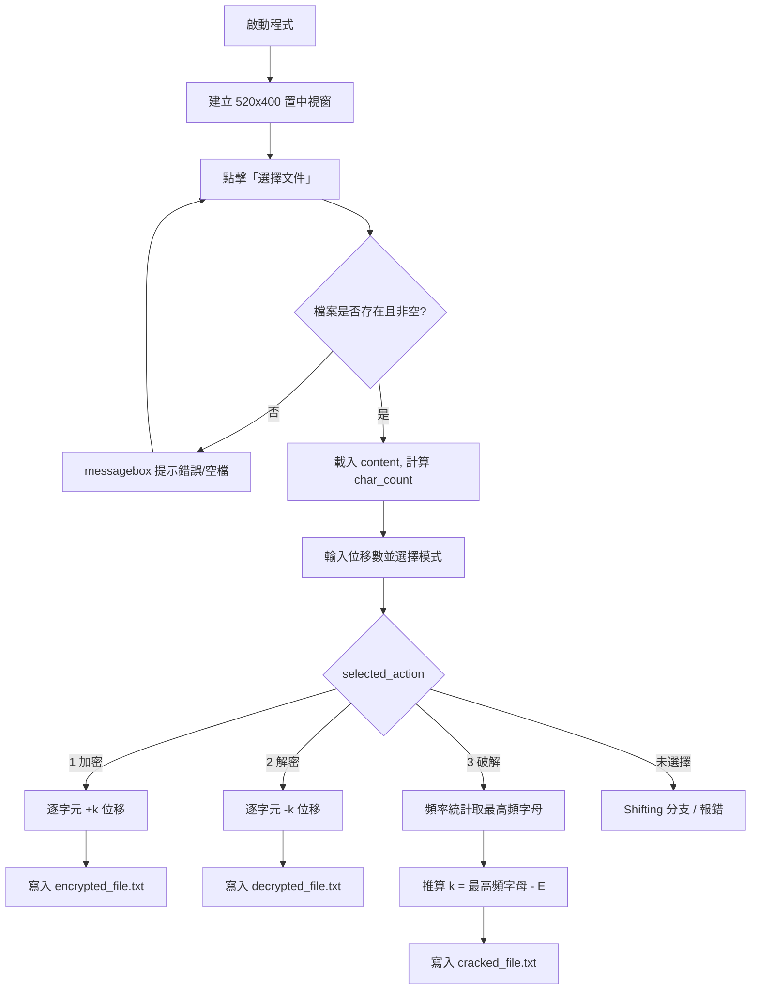

# 凱撒加密（Caesar Cipher）GUI 程式 —— 技術說明文件

> 對應原始碼：`sba_02_6b07.py`（共 132 行）
> 撰寫語言：Python 3（標準庫 `tkinter`）
> 文件性質：程式碼逆向說明 + 設計評析

---

## 目錄

1. [程式概述](#1-程式概述)
2. [執行流程](#2-執行流程)
3. [各函式說明](#3-各函式說明)
4. [演算法原理](#4-演算法原理)
5. [GUI 元件結構](#5-gui-元件結構)
6. [資料流與檔案輸出](#6-資料流與檔案輸出)
7. [已知問題](#7-已知問題)
8. [改進建議](#8-改進建議)
9. [附錄：核心邏輯重構示範](#9-附錄核心邏輯重構示範)

---

## 1. 程式概述

### 1.1 功能定位

本程式是一個以 **Tkinter** 製作的桌面小工具，實作古典密碼學中最基礎的 **凱撒密碼（Caesar Cipher）**，提供三種操作模式：

| 模式 | 功能 | 輸入 | 輸出檔案 |
|---|---|---|---|
| 加密（Encrypt） | 依使用者指定的位移數 `k` 加密明文 | 已載入的 `.txt` 檔案 + 位移數 | `encrypted_file.txt` |
| 解密（Decrypt） | 依使用者指定的位移數 `k` 還原密文 | 已載入的 `.txt` 檔案 + 位移數 | `decrypted_file.txt` |
| 破解（Crack） | 以「英文字母頻率分析」自動推測位移數並解密 | 已載入的 `.txt` 檔案 | `cracked_file.txt` |

### 1.2 技術特徵

- **零第三方依賴**：僅使用 Python 標準庫 `tkinter`、`tkinter.filedialog`、`tkinter.messagebox`。
- **字元處理層級**：以 `ord()` / `chr()` 直接操作 ASCII 碼位，而非使用 `str.translate` 或正則表達式。
- **大小寫分別處理**：大寫字母（ASCII 65–90）與小寫字母（97–122）各自獨立取模，非字母字元（空白、標點、中文）原樣保留。
- **全域狀態驅動**：程式大量使用 `global` 變數保存視窗狀態、檔案內容與運算結果，屬於典型的「腳本式」而非「物件導向」寫法。
- **單一事件入口**：所有運算集中於 `encrypt_decrypt_crack()` 一個回呼函式中，以 `if / elif` 分派三種模式。

### 1.3 程式結構總覽

```
sba_02_6b07.py
├── 全域變數宣告（the_most, number, decode, encode）
├── 視窗建立與置中定位（root, geometry）
├── analyze_textfile()      讀檔並統計字元數
├── select_file()           開啟檔案選擇對話框
├── encrypt_decrypt_crack() 三模式核心運算（加密 / 解密 / 破解）
└── GUI 元件建立（Label / Button / Entry / Frame / Radiobutton）
    └── root.mainloop()     進入事件迴圈
```

---

## 2. 執行流程

### 2.1 啟動階段

1. **匯入模組**：`tkinter`、`filedialog`、`messagebox`。
2. **初始化全域變數**：
   - `the_most = 'A'`：頻率分析中出現次數最多的字母（預設 A）。
   - `number = 0`：該字母的出現次數計數器。
   - `decode = ''`、`encode = ''`：解密 / 加密結果的字串緩衝區。
3. **建立主視窗**：`root = tk.Tk()`，標題設為「凱撒加密」。
4. **視窗置中**：讀取螢幕解析度，以 `(螢幕寬 - 520) / 2`、`(螢幕高 - 400) / 2` 計算左上角座標，透過 `geometry("520x400+left+top")` 套用，使視窗固定為 520×400 並居中顯示。
5. **建立 GUI 元件**（詳見第 5 節），最後呼叫 `root.mainloop()` 進入事件迴圈，等待使用者操作。

### 2.2 三條主要操作路徑

#### 路徑 A：選擇檔案（必經前置步驟）

```
使用者點擊「選擇文件」
   └─ select_file()
        ├─ filedialog.askopenfilename(filetypes=[("文本文件", ".txt")])
        │     └─ 使用者取消 → 回傳空字串 ""
        ├─ analyze_textfile(file_path)
        │     ├─ 成功 → 讀入全域 content，計算 char_count
        │     │            └─ 若 char_count == 0 → 彈出「文件為空。」
        │     └─ FileNotFoundError → 彈出「找不到文件。」
        └─ file_label.config(text=f"已選擇文件: {file_path}")
```

#### 路徑 B：加密 / 解密

```
輸入位移數 k → 選取「加密」或「解密」無線電鈕 → 點擊「執行」
   └─ encrypt_decrypt_crack()
        ├─ action = selected_action.get()          # 1=加密, 2=解密, 3=破解
        ├─ k = int(shift_entry.get())              # 轉型失敗 → 彈錯誤視窗（但未中斷）
        ├─ 逐字元掃描 content（索引 0 ~ char_count-1）
        │     ├─ 65 ≤ ord(c) ≤ 90   → 大寫字母位移後取模 26
        │     ├─ 97 ≤ ord(c) ≤ 122  → 小寫字母位移後取模 26
        │     └─ 其他              → 原樣複製
        ├─ 結果累加至 encode / decode 全域字串
        └─ 寫入 encrypted_file.txt / decrypted_file.txt（相對路徑 = 當前工作目錄）
```

#### 路徑 C：頻率分析破解

```
選取「破解」→ 點擊「執行」
   └─ encrypt_decrypt_crack()  (action == 3)
        ├─ k = 0
        ├─ 重新讀取 file_path 內容 → content
        ├─ file_path = content.upper()             # ⚠ 變數被覆寫為「大寫後的全文」
        ├─ 統計 A~Z 出現次數（for i in 65..90）
        │     └─ 取出現最多的字母 → the_most、number
        ├─ 若 the_most != 'E'：
        │     └─ k = ord(the_most) - ord('E')
        │     └─ 以 k 為位移數對 content 逐字元解密 → decode
        ├─ 組合輸出字串："位移數:k\n" + decode
        └─ 寫入 cracked_file.txt
```

### 2.3 流程圖



---

## 3. 各函式說明

### 3.1 `analyze_textfile(file_path)`

| 項目 | 內容 |
|---|---|
| 位置 | 第 20–28 行 |
| 簽名 | `def analyze_textfile(file_path):` |
| 回傳值 | 無（`None`），結果透過 `global` 寫回 |
| 作用 | 讀取指定文字檔全文，取得字元總數，作為後續迴圈的長度依據 |

**實作要點**

- 使用 `with open(file_path, 'r', encoding='UTF-8')` 開啟，確保檔案自動關閉，並明確指定 UTF-8 以支援中文內容。
- `content = file.read()` 一次讀入全文，`char_count = len(content)` 取得字元數。
- 若 `char_count == 0`，彈出資訊視窗「文件為空。」，**但不中斷流程**。
- 僅捕捉 `FileNotFoundError`；若發生 `UnicodeDecodeError`（非 UTF-8 檔案）或 `IsADirectoryError`，程式會直接拋出例外。

**全域變數副作用**

| 變數 | 型別 | 說明 |
|---|---|---|
| `content` | `str` | 檔案全文 |
| `char_count` | `int` | 全文長度（含換行、空白） |

**設計觀察**：函式名稱語意為「分析」，但實際只做「讀取 + 計數」，未進行任何統計分析；且 `char_count` 本可於使用處以 `len(content)` 求得，額外維護一個全域變數屬於冗餘狀態。

---

### 3.2 `select_file()`

| 項目 | 內容 |
|---|---|
| 位置 | 第 30–33 行 |
| 簽名 | `def select_file():` |
| 回傳值 | 無 |
| 作用 | 開啟檔案選擇對話框，並將選擇結果交給 `analyze_textfile()` 處理 |

**實作要點**

```python
file_path = filedialog.askopenfilename(filetypes=[("文本文件", ".txt")])
analyze_textfile(file_path)
file_label.config(text=f"已選擇文件: {file_path}")
```

- `filetypes=[("文本文件", ".txt")]` 限定只顯示 `.txt`，但**未加 `all files` 選項**；同時 Windows 下此過濾器僅為顯示層過濾，使用者仍可手動輸入其他路徑。
- `askopenfilename()` 在**使用者按下取消**時回傳空字串 `""`，程式未做判斷，直接傳入 `analyze_textfile("")`，會觸發 `FileNotFoundError` 並彈出「找不到文件。」，屬於**誤導性提示**（使用者並未選錯檔案，只是取消）。
- 無論讀取成功與否，`file_label` 都會更新為「已選擇文件: （空）」或完整路徑。

---

### 3.3 `encrypt_decrypt_crack()`

| 項目 | 內容 |
|---|---|
| 位置 | 第 35–88 行 |
| 簽名 | `def encrypt_decrypt_crack():` |
| 回傳值 | 無 |
| 作用 | 依無線電鈕選擇的模式，執行加密 / 解密 / 破解，並將結果寫入檔案 |

此函式是全程式唯一的運算入口，以 `selected_action` 的整數值進行分派：

#### 分支一：`action == 1`（加密）

```python
k = int(shift_entry.get())        # 取得位移數
for i in range(char_count):
    if 64 < ord(content[i]) < 91:                     # 大寫 A-Z
        encode += chr((ord(content[i]) + k - ord("A")) % 26 + ord("A"))
    elif 96 < ord(content[i]) < 123:                  # 小寫 a-z
        encode += chr((ord(content[i]) + k - ord("a")) % 26 + ord("a"))
    else:                                             # 非字母
        encode += chr(ord(content[i]))
with open("encrypted_file.txt", 'w', encoding='UTF-8') as file:
    file.write(encode)
    messagebox.showinfo("加密完成", "encrypted_file已寫入文件夾。")
```

- 位移公式：`E(x) = (x - 'A' + k) mod 26 + 'A'`（大寫）／以 `'a'` 為基準（小寫）。
- `%26` 保證 `k` 為任意整數（含負數、>26）時仍落在合法字母範圍內。
- 非字母字元（含中文、數字、標點、換行）透過 `else` 分支原樣輸出，故**中文內容不會被破壞**，但也不具備加密效果。
- 輸出檔名為**相對路徑**，實際落地位置為「Python 行程的當前工作目錄」，而非來源檔案所在資料夾。

#### 分支二：`action == 2`（解密）

與加密邏輯完全對稱，僅將 `+ k` 改為 `- k`：

```python
decode += chr((ord(content[i]) - k - ord("A")) % 26 + ord("A"))
```

Python 的 `%` 對負數回傳非負餘數（如 `(-3) % 26 == 23`），因此無需額外處理借位問題，這是本實作能安全使用減法取模的關鍵前提。

#### 分支三：`action == 3`（破解）

```python
k = 0
with open(file_path, 'r', encoding='UTF-8') as file:
    content = file.read()
    file_path = content.upper()          # 覆寫變數，後續作為「大寫全文」使用

for i in range(ord("A"), ord("Z") + 1):
    x = file_path.count(chr(i))
    if x > number:                        # number 為全域，未重置
        number = x
        the_most = chr(i)

if ord(the_most) != ord('E'):
    k = ord(the_most) - ord('E')
    for i in range(char_count):
        ...（以 -k 解密）...
shifting = f"位移數:{k}\n"
```

- 先以 `count()` 統計 A–Z 出現次數，取出最高頻字母 `the_most`。
- 以「英文最高頻字母為 E」為假設，推算 `k = the_most - 'E'`。
- 若 `the_most` 恰為 `E`，程式認定位移為 0，**跳過解密迴圈**，`decode` 保持原值（可能是空字串或前一輪殘留）。
- 輸出格式為第一行 `位移數:k`，第二行起為解密後的全文。

#### `else` 分支（未選擇模式）

```python
else:
    try:
        shifting = f"位移數:{k}\n"
    except NameError:
        messagebox.showerror("錯誤", "請選擇模式")
```

此分支僅嘗試讀取 `k` 並格式化字串，成功時**無任何輸出或提示**，屬於實作未完成的分支（詳見第 7 節）。

---

## 4. 演算法原理

### 4.1 凱撒加密（Caesar Cipher）

#### 4.1.1 數學模型

凱撒密碼屬於**單表替換密碼（monoalphabetic substitution cipher）**，將每個字母沿字母表固定方向平移 `k` 位：

$$
E_k(x) = (x + k) \bmod 26, \qquad D_k(y) = (y - k) \bmod 26
$$

其中 `x`、`y` 為字母在 `A=0 … Z=25` 座標系中的索引。程式對照的實作為：

| 步驟 | 大寫字母 | 小寫字母 |
|---|---|---|
| 轉為 0–25 索引 | `ord(c) - ord('A')` | `ord(c) - ord('a')` |
| 位移並取模 | `(idx + k) % 26` | 同左（以 `k` 正負區分加解密） |
| 還原 ASCII | `+ ord('A')` → `chr()` | `+ ord('a')` → `chr()` |

#### 4.1.2 密鑰空間

`k` 的有效範圍為 `0–25`，共 **26 種**（`k=0` 等同不加密）。此密鑰空間極小，等同於**暴力破解只需嘗試 25 次**，因此凱撒密碼在現代不具任何安全強度，僅作教學用途。

#### 4.1.3 大小寫與非字母處理策略

程式採用 **「逐字元分類處理」** 策略：

```
輸入字元 c
├─ 'A' ≤ c ≤ 'Z' → 大寫位移（保持大寫）
├─ 'a' ≤ c ≤ 'z' → 小寫位移（保持小寫）
└─ 其他（數字、標點、空白、換行、中文）→ 原樣輸出
```

此設計確保：

1. **可還原性**（正確性）：加解密互為反函式，`D_k(E_k(m)) = m`。
2. **格式保留性**：空白與標點不被轉換，維持可讀性與單詞邊界。
3. **中文安全性**：UTF-8 中文字元碼位遠大於 122，落入 `else` 分支原樣保留。

> 邊界細節：判斷式使用 `64 < ord(c) < 91` 與 `96 < ord(c) < 123`，即等價於 `65 ≤ ord(c) ≤ 90` 與 `97 ≤ ord(c) ≤ 122`，邊界正確。

---

### 4.2 凱撒解密

解密即為加密的逆運算：將每個字母反向平移 `k` 位。

程式未使用「先求 `26 - k` 再加」的技巧，而是**直接以 `- k` 參與取模**：

```python
chr((ord(c) - k - ord('A')) % 26 + ord('A'))
```

此寫法在 Python 中安全，因為 Python 的 `%` 運算子遵循「餘數與除數同號」規則，對負被除數會回傳正餘數：

| 運算式 | Python 結果 | 說明 |
|---|---|---|
| `(0 - 3) % 26` | `23` | 等價於 `-3 mod 26` |
| `(2 - 5) % 26` | `23` | 借位後仍落在 0–25 |

若改以 C / Java 等語言實作，`%` 對負數可能回傳負值，需額外補 `+26`。

---

### 4.3 頻率分析破解（Frequency Analysis）

#### 4.3.1 原理

英文字母在自然語言中的出現頻率並不均勻，其中 **`E` 為最高頻字母**（一般英文文本約占 12.7%）。因此對單表替換密碼，只要統計密文中各字母的出現次數，出現最多次的字母極可能對應明文的 `E`，即可反推位移數：

$$
k_{\text{推定}} = \bigl(\text{index}(\text{最高頻字母}) - \text{index}('E')\bigr) \bmod 26
$$

#### 4.3.2 程式實作步驟

| 步驟 | 程式碼 | 說明 |
|---|---|---|
| ① 讀取並正規化 | `content = file.read()`；`file_path = content.upper()` | `upper()` 使大小寫合併統計，避免同一字母被拆分為兩個計數 |
| ② 逐一計數 | `for i in range(65, 91): x = file_path.count(chr(i))` | 對 A–Z 共 26 個字母各執行一次 `count()` |
| ③ 取最大值 | `if x > number: number = x; the_most = chr(i)` | 嚴格大於（`>`）比較，故同頻時保留**字母序較前**者 |
| ④ 推算位移 | `k = ord(the_most) - ord('E')` | 未取模 26，但因差值必在 `-25 ~ +25` 之間，後續取模仍正確 |
| ⑤ 解密 | 以 `-k` 逐字元還原 | 與手動解密邏輯相同 |
| ⑥ 輸出 | 首行 `位移數:k`，續接明文 | 便於人工核對 |

#### 4.3.3 方法有效性與限制

**適用條件**

- 文本為**英文**、長度足夠（經驗上 > 100 字元時命中率較高）。
- 位移固定（純凱撒），非 Vigenère 等多表密碼。

**失效情境**

| 情境 | 後果 |
|---|---|
| 文本過短（如 `"hello"`） | 樣本不足，最高頻字母可能不是 `E`，`k` 推定錯誤 |
| 文本為中文或數字為主 | A–Z 計數全為 0，`the_most` 停留在初始值 `'A'`，誤判 `k = -4` |
| 特殊文體（如大量 `Z`、`Q`） | 頻率分佈偏離自然語言 |
| 最高頻字母恰為 `E` | 直接用 `k = 0`，且**跳過解密迴圈** → 輸出檔案可能只有 `位移數:0` 一行（Bug，見第 7 節） |

**理論改進方向**：以 **卡方檢定（Chi-square）** 或**餘弦相似度**對全部 26 種位移分別計算與標準英文頻率表的擬合度，取誤差最小者，可大幅提升短文本與異常文體的破解準確率。

---

## 5. GUI 元件結構

### 5.1 元件樹

```
root (tk.Tk, title="凱撒加密", 520x400, 置中)
├── file_label        (Label)       "已選擇文件: "
├── select_file_button(Button)      "選擇文件"  → select_file
├── shift_label       (Label)       "輸入位移數:"
├── shift_entry       (Entry)       位移數輸入框
├── button_frame      (Frame)
│   ├── encrypt_radio (Radiobutton) "加密"  value=1  side=LEFT
│   ├── crack_radio   (Radiobutton) "破解"  value=3  side=RIGHT
│   └── decrypt_radio (Radiobutton) "解密"  value=2  side=RIGHT
└── action_button     (Button)      "執行"   → encrypt_decrypt_crack
```

### 5.2 元件屬性一覽

| 元件 | 類型 | 關鍵屬性 | 綁定 / 作用 |
|---|---|---|---|
| `root` | `tk.Tk` | `title`、`geometry` | 主視窗容器；尺寸由螢幕解析度計算後置中 |
| `file_label` | `tk.Label` | `text` | 顯示目前選取檔案路徑 |
| `select_file_button` | `tk.Button` | `text="選擇文件"`、`command=select_file` | 觸發檔案選擇對話框 |
| `shift_label` | `tk.Label` | `text="輸入位移數:"` | 輸入框說明文字 |
| `shift_entry` | `tk.Entry` | 無預設值 | 接收使用者輸入的整數位移數 |
| `button_frame` | `tk.Frame` | 無 | 橫向排列三個無線電鈕的容器 |
| `encrypt_radio` | `tk.Radiobutton` | `value=1`、`side=LEFT` | 選擇加密模式 |
| `decrypt_radio` | `tk.Radiobutton` | `value=2`、`side=RIGHT` | 選擇解密模式 |
| `crack_radio` | `tk.Radiobutton` | `value=3`、`side=RIGHT` | 選擇破解模式 |
| `selected_action` | `tk.IntVar` | 初始值 `0` | 三個無線電鈕共享的狀態變數 |
| `action_button` | `tk.Button` | `text="執行"`、`command=encrypt_decrypt_crack` | 觸發核心運算 |

### 5.3 版面配置分析

- 全部使用 `pack()` 佈局，**未混用 `grid()` / `place()`**，因此垂直堆疊順序即為程式碼中的建立順序：檔案標籤 → 選擇按鈕 → 位移標籤 → 輸入框 → 模式選擇列 → 執行按鈕。
- `button_frame` 內的無線電鈕以 `side=tk.LEFT` / `side=tk.RIGHT` 排列。由於 `encrypt_radio` 先 `pack(side=LEFT)`，而後兩個均為 `side=RIGHT`，實際顯示順序為：**加密（最左）→ 解密 → 破解（最右）**。
- 視窗尺寸固定 520×400，未設定 `resizable(False, False)`，使用者仍可手動縮放；但元件不會隨視窗重新佈局，放大後下方會留白。
- 未設定 `font`、`padding`、`bg`，外觀完全採用 Tk 預設主題。

### 5.4 狀態機

```
selected_action = 0（未選擇，預設）
        │
        ├── 點「加密」 → 1 → 執行 → 走加密分支
        ├── 點「解密」 → 2 → 執行 → 走解密分支
        └── 點「破解」 → 3 → 執行 → 走破解分支
```

> 由於 `IntVar` 預設為 `0`，程式啟動時**沒有任何無線電鈕被選中**，使用者若直接點「執行」會落入 `else` 分支（未完成的錯誤處理路徑）。

---

## 6. 資料流與檔案輸出

### 6.1 全域變數生命週期

| 變數 | 初始值 | 寫入時機 | 讀取時機 | 是否重置 |
|---|---|---|---|---|
| `content` | 未定義 | `analyze_textfile()` / 破解分支重讀 | 加解密迴圈 | 每次選檔覆寫 |
| `char_count` | 未定義 | `analyze_textfile()` | 三個模式的 `range()` | 每次選檔覆寫 |
| `file_path` | 未定義 | `select_file()`；破解分支被覆寫為大寫全文 | 讀檔、Label 顯示 | **破解時被破壞性覆寫** |
| `encode` | `''` | 加密迴圈累加 | 寫檔 | **否**（跨次累積） |
| `decode` | `''` | 解密 / 破解迴圈累加 | 寫檔 | **否**（跨次累積） |
| `the_most` | `'A'` | 破解頻率統計 | 破解位移推算 | **否** |
| `number` | `0` | 破解頻率統計 | 破解位移推算 | **否** |
| `k` | 未定義 | 各分支賦值 | 位移計算 | 區域/全域混用 |

### 6.2 輸出檔案規格

| 檔案 | 產生模式 | 內容格式 | 編碼 |
|---|---|---|---|
| `encrypted_file.txt` | 加密 | 密文全文（結構與原文相同） | UTF-8 |
| `decrypted_file.txt` | 解密 | 明文全文 | UTF-8 |
| `cracked_file.txt` | 破解 | 第 1 行 `位移數:k`，第 2 行起為解密全文 | UTF-8 |

**落地位置**：三者皆使用相對路徑，寫入「Python 行程的當前工作目錄（`os.getcwd()`）」。以雙擊方式執行時，通常為 `.py` 檔所在資料夾；若從 IDE 或命令列啟動，則可能落在專案根目錄，使用者容易找不到檔案。

---

## 7. 已知問題

> 以下問題均基於原始碼靜態分析得出，依嚴重程度分級：🔴 功能性錯誤 / 🟡 邏輯缺陷 / ⚪ 程式風格。

### 7.1 🔴 全域緩衝區未重置，導致重複執行結果累加

`encode` 與 `decode` 在模組層級初始化為 `''`，但在 `encrypt_decrypt_crack()` 中**從未清空**。連續執行兩次加密時，第二次的輸出會變成「第一次密文 + 第二次密文」：

```python
encode = encode + chr(...)   # 每次都接在既有字串後面
```

**影響**：同一檔案重複加密 / 解密，輸出檔案內容不斷變長且錯誤。這是本程式最嚴重的功能性缺陷。

### 7.2 🔴 破解模式在「最高頻字母為 E」時輸出錯誤

```python
if ord(the_most) != ord('E'):
    k = ord(the_most) - ord('E')
    for i in range(char_count): ...   # 解密迴圈
# 若 the_most == 'E'，此處完全跳過
shifting = f"位移數:{k}\n"
```

當明文最高頻字母為 `E`（即位移 `k = 0`）時：

- `decode` 保持原值（`''` 或上一輪殘留），**明文未被解密**。
- 輸出檔只剩 `位移數:0` 一行，內容遺失。

正確做法應為：`k = 0` 時仍需將 `content` 原樣寫入 `decode`。

### 7.3 🔴 位移數輸入錯誤後未中斷流程

```python
try:
    k = int(shift_entry.get())
except ValueError:
    messagebox.showerror("錯誤", "請輸入位移數")
for i in range(char_count):     # ← 仍會繼續執行
```

`except` 區塊僅彈出提示，**未 `return`**。若使用者輸入非數字（如空白或 `abc`），程式會繼續執行迴圈，此時 `k` 未定義 → 拋出 `NameError`（或使用上一次殘留值產生錯誤結果）。同時，若 `content` 尚未載入，`char_count` 亦未定義，會先拋 `NameError`。

### 7.4 🟡 `file_path` 在破解分支被覆寫為檔案內容

```python
with open(file_path, 'r', ...) as file:
    content = file.read()
    file_path = content.upper()      # 同名變數語意突變
```

`file_path` 原本代表「檔案路徑」，此處被改寫為「大寫後的全文」。後果：

1. 破壞其他功能對 `file_path` 的依賴（若日後擴充「重新讀取」或「另存」功能將失敗）。
2. `file_label` 若再次刷新，可能顯示整篇文本。
3. 可讀性極差，屬典型的「變數複用」反模式。應改用 `upper_content` 之類的獨立變數。

### 7.5 🟡 破解統計未重置 `number` / `the_most`

`number` 與 `the_most` 為全域且未在破解前重置。若先前已破解過一次，`number` 可能保留較大值，導致本次統計的 `if x > number` 永不成立，`the_most` 沿用上次結果 → **位移數推定完全錯誤**。

### 7.6 🟡 取消檔案選擇時提示訊息誤導

`askopenfilename()` 取消時回傳 `""`，`analyze_textfile("")` 觸發 `FileNotFoundError` → 彈出「找不到文件。」。使用者實際上是「主動取消」，而非「檔案不存在」，提示語意錯位。

### 7.7 🟡 檔案讀取例外處理不完整

僅捕捉 `FileNotFoundError`，未處理：

- `UnicodeDecodeError`：非 UTF-8 編碼（如 Big5、GBK）的 `.txt` 會直接崩潰。
- `IsADirectoryError` / `PermissionError`：權限不足或誤選資料夾。
- `OSError`：磁碟錯誤、檔案被鎖定。

### 7.8 🟡 空檔案仍會繼續執行

`char_count == 0` 時雖彈出「文件為空。」，但**未中止**流程。後續進入加密分支仍會建立一個空的 `encrypted_file.txt` 並提示「加密完成」，行為不一致。

### 7.9 🟡 未選擇模式時的 `else` 分支實作不完整

```python
else:
    try:
        shifting = f"位移數:{k}\n"
    except NameError:
        messagebox.showerror("錯誤", "請選擇模式")
```

- 若 `k` 恰好在先前流程被賦值（全域殘留），`f-string` 不會拋錯，程式**靜默結束、無任何提示**。
- 變數 `shifting` 建立後從未使用。
- 正確做法應為直接檢查 `action == 0` 並提示「請選擇模式」，無需 `try/except`。

### 7.10 🟡 輸出檔名硬編碼且不可選擇

- 檔名固定為 `encrypted_file.txt` 等，多次操作會**無聲覆蓋**先前結果。
- 無「另存新檔」對話框，使用者無法指定輸出路徑。
- 提示文字「encrypted_file已寫入文件夾」未說明具體位置；破解完成提示誤寫為 `carcked_file`（拼寫錯誤，且與實際檔名 `cracked_file.txt` 不符）。

### 7.11 ⚪ 字串串接效率低落

迴圈中使用 `encode = encode + chr(...)` 進行累加。Python 字串不可變，每次串接都需複製整個字串，時間複雜度為 **O(n²)**。處理大型檔案（如數 MB）時明顯卡頓。應改用 `list.append()` + `''.join()`。

### 7.12 ⚪ 三份高度重複的位移邏輯

加密、解密、破解三個分支各自複製了一份幾乎相同的「逐字元位移」程式碼（`if/elif/else` 區塊共出現三次）。任何邏輯修正都需同步修改三處，維護風險高，違反 DRY 原則。

### 7.13 ⚪ 其他細節

| 項目 | 說明 |
|---|---|
| `file.close()` | 寫在 `with` 區塊內，屬多餘呼叫（`with` 已自動關閉） |
| 無 `if __name__ == "__main__":` | 檔案被 `import` 時會立即建立視窗，無法作為模組重用 |
| 無 `resizable(False, False)` | 視窗可縮放但佈局不自適應 |
| 無輸入驗證 | 位移數可為負數或 > 26（雖取模後仍正確，但語意不直觀） |
| 無輸出預覽 | 使用者只能寫檔後再用外部編輯器檢視結果 |
| 無進度回饋 | 大檔案處理期間 UI 凍結，無 loading 提示 |
| PEP 8 不符 | 運算子前後空格不一致（如 `range (char_count)`）、運算式過長、註解格式混雜 |
| 型別註記缺失 | 所有函式均無 type hints 與 docstring |
| 全域變數過多 | 8 個 `global` 宣告，狀態難以追蹤，不利測試 |

### 7.14 密碼學層面的固有限制

- **密鑰空間僅 26**：暴力枚舉即可在瞬間破解，無實際安全性。
- **頻率特徵保留**：單表替換不改變字母頻率分佈，天然可被頻率分析攻破。
- **無完整性驗證**：無 MAC / 校驗，密文可被任意篡改而無法察覺。
- **無 IV / 隨機性**：相同明文 + 相同 `k` 永遠產生相同密文，可做已知明文比對。

---

## 8. 改進建議

### 8.1 優先級一：修正功能性錯誤（必須）

| 編號 | 問題 | 修正方式 |
|---|---|---|
| 1 | 重複執行累加 | 在 `encrypt_decrypt_crack()` 開頭重置 `encode = decode = ''` |
| 2 | 破解 `k == 0` 輸出錯誤 | 移除 `if the_most != 'E'` 判斷，統一將 `content` 解密後寫入（`k=0` 時即原樣輸出） |
| 3 | 位移數錯誤未中斷 | `except ValueError:` 中加入 `return`；或改用 `tk.Spinbox` 限定輸入 |
| 4 | 破解統計殘留 | 破解前重置 `number = 0`、`the_most = 'A'` |
| 5 | 空檔案仍執行 | `char_count == 0` 時 `return` |

### 8.2 優先級二：重構核心邏輯（強烈建議）

**（1）抽離純函式，消除三份重複程式碼**

```python
def caesar(text: str, k: int) -> str:
    """將 text 中的英文字母位移 k 位，其他字元保持不變。"""
    result = []
    for ch in text:
        if 'A' <= ch <= 'Z':
            result.append(chr((ord(ch) - 65 + k) % 26 + 65))
        elif 'a' <= ch <= 'z':
            result.append(chr((ord(ch) - 97 + k) % 26 + 97))
        else:
            result.append(ch)
    return ''.join(result)
```

- 加密：`caesar(content, k)`
- 解密：`caesar(content, -k)`
- 破解：`caesar(content, -k_cracked)`

一個函式同時解決「重複程式碼」與「O(n²) 串接」兩個問題，且便於單元測試。

**（2）以 `str.translate` 進一步加速**

```python
def make_table(k: int) -> dict:
    table = {}
    for i in range(26):
        table[ord('A') + i] = ord('A') + (i + k) % 26
        table[ord('a') + i] = ord('a') + (i + k) % 26
    return table

text.translate(make_table(k))
```

C 層實作，處理大檔案時效能提升顯著。

**（3）頻率統計改用 `collections.Counter`**

```python
from collections import Counter

def crack_key(text: str) -> int:
    letters = [c for c in text.upper() if 'A' <= c <= 'Z']
    if not letters:
        return 0
    most = Counter(letters).most_common(1)[0][0]
    return (ord(most) - ord('E')) % 26
```

**（4）改用卡方檢定提升破解準確率**

```python
ENGLISH_FREQ = {
    'A': 8.17, 'B': 1.49, 'C': 2.78, 'D': 4.25, 'E': 12.70, 'F': 2.23,
    'G': 2.02, 'H': 6.09, 'I': 6.97, 'J': 0.15, 'K': 0.77, 'L': 4.03,
    'M': 2.41, 'N': 6.75, 'O': 7.51, 'P': 1.93, 'Q': 0.10, 'R': 5.99,
    'S': 6.33, 'T': 9.06, 'U': 2.76, 'V': 0.98, 'W': 2.36, 'X': 0.15,
    'Y': 1.97, 'Z': 0.07,
}

def crack_key_chi2(text: str) -> int:
    letters = [c for c in text.upper() if 'A' <= c <= 'Z']
    n = len(letters)
    if n == 0:
        return 0
    counts = Counter(letters)
    best_k, best_score = 0, float('inf')
    for k in range(26):
        score = 0.0
        for i, letter in enumerate('ABCDEFGHIJKLMNOPQRSTUVWXYZ'):
            observed = counts.get(chr((i + k) % 26 + 65), 0)
            expected = ENGLISH_FREQ[letter] / 100 * n
            if expected > 0:
                score += (observed - expected) ** 2 / expected
        if score < best_score:
            best_score, best_k = score, k
    return best_k
```

對短文本與特殊文體的魯棒性遠優於「取最高頻字母」。

### 8.3 優先級三：使用者體驗與健壯性

| 面向 | 建議 |
|---|---|
| 檔案選擇 | 加入 `("所有檔案", "*.*")` 選項；取消時 `if not file_path: return` |
| 編碼兼容 | 讀檔時依序嘗試 `utf-8`、`utf-8-sig`、`big5`、`gbk`，並以 `errors='replace'` 兜底 |
| 例外處理 | 捕捉 `UnicodeDecodeError`、`PermissionError`、`OSError`，給出繁體中文提示 |
| 輸出路徑 | 使用 `filedialog.asksaveasfilename()` 讓使用者指定；預設檔名建議 `{原檔名}_encrypted.txt` |
| 覆蓋保護 | 寫檔前檢查 `os.path.exists()`，存在時詢問是否覆蓋 |
| 結果預覽 | 新增 `tk.Text` + `Scrollbar`，執行後即時顯示加解密結果 |
| 位移數輸入 | 改用 `tk.Spinbox(from_=1, to=25)`，天然限制合法範圍 |
| 預設模式 | `selected_action.set(1)`，避免啟動即落入 `else` 分支 |
| 進度回饋 | 大檔案處理前 `root.config(cursor="watch")` + `root.update()`，完成後還原 |
| 視窗佈局 | 改用 `grid()` 或加入 `padding=(10, 6)`，並設 `root.resizable(False, False)` |
| 狀態顯示 | 底部新增 `tk.Label` 顯示「已完成：位移數 k = 3，輸出至 ...」 |

### 8.4 優先級四：工程化與可維護性

1. **物件導向重構**：將 GUI 封裝為 `class CaesarApp(tk.Tk)`，以 `self.` 屬性取代全域變數，徹底消除 `global` 濫用。
2. **分層設計**：
   - `cipher.py`：純運算邏輯（`caesar`、`crack_key`），零 GUI 依賴，可獨立測試。
   - `app.py`：GUI 與事件綁定。
3. **加入 `if __name__ == "__main__":`** 保護入口。
4. **撰寫單元測試**：至少覆蓋 `k = 0`、`k = 25`、負數 `k`、大小寫混合、含中文標點等邊界案例；驗證 `D_k(E_k(m)) == m`。
5. **加入 type hints 與 docstring**，符合 PEP 8 / PEP 257。
6. **打包發佈**：以 `pyinstaller --noconsole --onefile` 產出 `.exe`，方便無 Python 環境的使用者執行。

### 8.5 安全層面提醒（教學用途定位）

凱撒密碼僅適用於教學與 CTF 入門，**不可用於任何真實資料保護**。若需實際加密，應改用：

- 對稱加密：AES-GCM（`cryptography` 套件的 `Fernet` 已封裝安全參數）
- 非對稱加密：RSA-2048 以上 / ECC
- 密碼雜湊：Argon2id / bcrypt（非加密，用於儲存密碼摘要）

---

## 9. 附錄：核心邏輯重構示範

以下為結合前述建議的精簡重構版，保留原有三種模式與中文介面，但修正主要缺陷：

```python
import tkinter as tk
from collections import Counter
from tkinter import filedialog, messagebox

ALPHA = 'ABCDEFGHIJKLMNOPQRSTUVWXYZ'


def caesar(text: str, k: int) -> str:
    """將英文字母位移 k 位（k 可為負），其他字元原樣保留。"""
    out = []
    for ch in text:
        if 'A' <= ch <= 'Z':
            out.append(chr((ord(ch) - 65 + k) % 26 + 65))
        elif 'a' <= ch <= 'z':
            out.append(chr((ord(ch) - 97 + k) % 26 + 97))
        else:
            out.append(ch)
    return ''.join(out)


def crack_key(text: str, expected: str = 'E') -> int:
    """以最高頻字母推測位移數；無英文字母時回傳 0。"""
    letters = [c for c in text.upper() if 'A' <= c <= 'Z']
    if not letters:
        return 0
    most = Counter(letters).most_common(1)[0][0]
    return (ord(most) - ord(expected)) % 26


class CaesarApp(tk.Tk):
    def __init__(self) -> None:
        super().__init__()
        self.title("凱撒加密")
        self.width, self.height = 520, 400
        x = (self.winfo_screenwidth() - self.width) // 2
        y = (self.winfo_screenheight() - self.height) // 2
        self.geometry(f"{self.width}x{self.height}+{x}+{y}")
        self.resizable(False, False)

        self.content = ""
        self.file_path = ""
        self.action = tk.IntVar(value=1)

        self._build_ui()

    def _build_ui(self) -> None:
        self.file_label = tk.Label(self, text="已選擇文件: ", anchor='w')
        self.file_label.pack(fill='x', padx=10)

        tk.Button(self, text="選擇文件", command=self.select_file).pack(pady=6)

        tk.Label(self, text="輸入位移數:").pack()
        self.shift_entry = tk.Entry(self, width=10, justify='center')
        self.shift_entry.insert(0, "3")
        self.shift_entry.pack(pady=4)

        frame = tk.Frame(self)
        frame.pack(pady=6)
        for text, value in (("加密", 1), ("解密", 2), ("破解", 3)):
            tk.Radiobutton(frame, text=text, variable=self.action, value=value).pack(side='left', padx=6)

        tk.Button(self, text="執行", command=self.run).pack(pady=8)

        self.preview = tk.Text(self, height=10, wrap='word')
        self.preview.pack(fill='both', expand=True, padx=10, pady=(0, 10))

    def select_file(self) -> None:
        path = filedialog.askopenfilename(
            filetypes=[("文本文件", "*.txt"), ("所有檔案", "*.*")]
        )
        if not path:                      # 使用者取消 → 靜默返回
            return
        try:
            with open(path, 'r', encoding='utf-8', errors='replace') as f:
                self.content = f.read()
        except OSError as exc:
            messagebox.showerror("錯誤", f"無法讀取檔案：{exc}")
            return
        if not self.content:
            messagebox.showinfo("提示", "文件為空。")
            return
        self.file_path = path
        self.file_label.config(text=f"已選擇文件: {path}")

    def run(self) -> None:
        if not self.content:
            messagebox.showerror("錯誤", "請先選擇文件")
            return

        mode = self.action.get()
        if mode == 1:
            try:
                k = int(self.shift_entry.get())
            except ValueError:
                messagebox.showerror("錯誤", "位移數必須是整數")
                return
            result, out_name = caesar(self.content, k), "encrypted_file.txt"
        elif mode == 2:
            try:
                k = int(self.shift_entry.get())
            except ValueError:
                messagebox.showerror("錯誤", "位移數必須是整數")
                return
            result, out_name = caesar(self.content, -k), "decrypted_file.txt"
        else:
            k = crack_key(self.content)
            result = f"位移數:{k}\n" + caesar(self.content, -k)
            out_name = "cracked_file.txt"

        try:
            with open(out_name, 'w', encoding='utf-8') as f:
                f.write(result)
        except OSError as exc:
            messagebox.showerror("錯誤", f"寫入失敗：{exc}")
            return

        self.preview.delete('1.0', 'end')
        self.preview.insert('1.0', result)
        messagebox.showinfo("完成", f"已寫入 {out_name}（位移數 k = {k}）")


if __name__ == "__main__":
    CaesarApp().mainloop()
```

**重構前後對照**

| 對照項 | 原始版本 | 重構版本 |
|---|---|---|
| 全域變數數量 | 8 個 | 0 個（改用實例屬性） |
| 位移邏輯重複次數 | 3 份 | 1 份（`caesar()`） |
| 字串串接複雜度 | O(n²) | O(n)（`list` + `join`） |
| `k=0` 破解 | 輸出錯誤 | 正確輸出原文 |
| 位移數輸入錯誤 | 繼續執行並崩潰 | 提示後 `return` |
| 取消選檔 | 誤報「找不到文件」 | 靜默返回 |
| 輸出結果可見性 | 需外部開啟檔案 | 內嵌 `Text` 預覽 |
| 可測試性 | 無法脫離 GUI 測試 | `cipher` 函式可獨立測試 |

---

## 結語

本程式以簡潔直白的方式完整實作了凱撒密碼的**加密、解密與頻率分析破解**三大功能，對初學者理解「古典密碼 + Tkinter 事件驅動」的組合具有良好教學價值。其核心位移公式 `(ord(c) ± k - base) % 26 + base` 正確且穩健，能安全處理任意整數位移與非字母字元。

主要待改進之處集中在**狀態管理**（全域變數未重置、變數複用）與**錯誤處理**（例外未中斷流程、例外類型覆蓋不足），這些問題在單次操作流程中不易察覺，但一旦連續操作或遭遇異常輸入便會顯現。依第 8 節的優先級逐項修正後，即可將其升級為結構清晰、可測試、可維護的小型專案。
*（内容由AI生成，仅供参考）*
