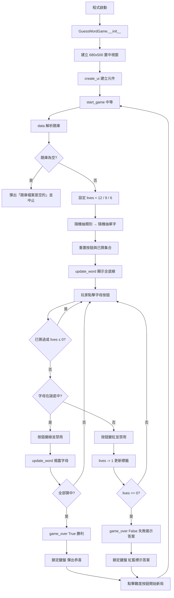
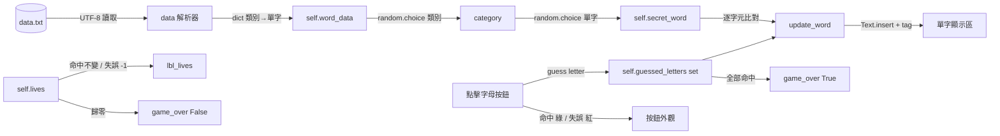

# 猜單字遊戲（Guess Word Game）—— 技術說明文件

> 對應原始碼：`Game.py`（182 行）、`data.txt`（3 行）
> 執行環境：Python 3 + tkinter（標準庫，無第三方依賴）
> 文件性質：程式碼逆向說明 + 設計評析

---

## 目錄

1. [專案概述](#1-專案概述)
2. [題庫檔案格式](#2-題庫檔案格式)
3. [類別與各方法說明](#3-類別與各方法說明)
4. [遊戲流程與難度機制](#4-遊戲流程與難度機制)
5. [GUI 元件結構](#5-gui-元件結構)
6. [資料流](#6-資料流)
7. [已知問題](#7-已知問題)
8. [改進建議](#8-改進建議)
9. [附錄：重構示範](#9-附錄重構示範)

---

## 1. 專案概述

### 1.1 遊戲定位

本專案是一個以 **Tkinter** 實作的 **英文字彙猜字遊戲（Hangman 變體）**。玩家在畫面上看到一組以底線表示的單字（如 `_ _ _ _ _`）與一個類別提示（如「水果」），需從 26 個字母按鈕中逐一點選，猜出隱藏的英文單字。

與傳統 Hangman 的差異在於：

| 特性 | 傳統 Hangman | 本程式 |
|---|---|---|
| 失敗呈現 | 逐筆畫出吊人圖 | 僅遞減「剩餘機會」數字 |
| 輸入方式 | 鍵盤打字 | 螢幕字母按鈕（點擊） |
| 難度 | 固定 | 三檔（12 / 9 / 6 次） |
| 題庫 | 內建或外部 | 外部 `data.txt`，可自由擴充 |

### 1.2 技術特徵

- **物件導向設計**：全部遊戲狀態與行為封裝於 `GuessWordGame` 類別，以 `self.` 屬性保存，無任何 `global` 變數。
- **資料驅動題庫**：單字不寫死於程式，而是從 `data.txt` 解析，支援「類別 : 逗號分隔單字」格式，並具備「檔案不存在則自動建立預設題庫」的自癒機制。
- **動態 UI 生成**：26 個字母按鈕以迴圈 + `grid()` 程式化產生，而非逐一硬編碼。
- **單一入口保護**：以 `if __name__ == "__main__":` 包裹啟動邏輯，可作為模組被匯入。
- **零依賴**：僅使用 `tkinter`、`random`、`os` 三個標準庫模組。

### 1.3 檔案組成

| 檔案 | 行數 | 角色 |
|---|---|---|
| `Game.py` | 182 | 主程式：GUI、遊戲邏輯、題庫解析 |
| `data.txt` | 3 | 題庫資料：類別 → 單字清單 |

### 1.4 程式結構總覽

```
Game.py
└── class GuessWordGame
    ├── __init__(root)        初始化視窗、狀態變數、UI、啟動第一局
    ├── create_ui()           建立全部 GUI 元件（難度列 / 資訊列 / 單字顯示 / 字母鍵盤）
    ├── data()                解析 data.txt，回傳 {類別: [單字...]}；缺檔時自動建立
    ├── start_game(diff)      依難度設定生命值，抽題，重置 UI 與狀態
    ├── update_word()         依已猜字母重繪底線/字母；判斷是否勝利
    ├── guess(letter)         處理一次猜測：命中→變綠、失誤→變紅並扣命
    └── game_over(won)        結束遊戲：鎖定鍵盤，顯示結果對話框
```

> 註：`create_ui()` 為輔助方法，但程式未以 `_` 前綴標示其私有性，命名風格上與其他方法一致。

---

## 2. 題庫檔案格式

### 2.1 檔案內容

`data.txt` 目前僅 3 行，內容如下：

```text
水果: APPLE, BANANA, ORANGE, GRAPE, MANGO
動物: TIGER, LION, ZEBRA, PANDA, KOALA
國家: TAIWAN, JAPAN, KOREA, CANADA, FRANCE
```

### 2.2 格式規範

```
<類別名稱> : <單字1> , <單字2> , <單字3> ...
```

| 元素 | 規則 | 解析後處理 |
|---|---|---|
| 類別名稱 | 冒號 `:` 之前的所有文字 | `strip()` 去除前後空白 |
| 分隔符 | 半形冒號 `:`（**全形 `：` 無效**） | `split(":")` 切割 |
| 單字分隔 | 半形逗號 `,` | `split(",")` 切割 |
| 單字清理 | — | `strip()` 去空白 → `upper()` 轉大寫 |
| 空單字 | 連續逗號或尾逗號產生空字串 | `if w.strip()` 過濾丟棄 |
| 空類別 | 冒號後無有效單字 | `if words_clean:` 整行跳過 |

### 2.3 解析邏輯（`data()` 方法）

```python
data = {}
with open(self.data_file, "r", encoding="utf-8") as f:
    for line in f:
        if ":" in line:
            parts = line.split(":")
            category = parts[0].strip()
            words_raw = parts[1].split(",")
            words_clean = [w.strip().upper() for w in words_raw if w.strip()]
            if words_clean:
                data[category] = words_clean
return data
```

**逐步說明**

1. 逐行讀取，`if ":" in line` 過濾掉無冒號的行（空白行、純註解行都會被靜默忽略）。
2. `line.split(":")` 以冒號切割，`parts[0]` 為類別、`parts[1]` 為單字串。
3. `words_raw = parts[1].split(",")` 以逗號切割為單字清單。
4. **串列推導式**同時完成「去空白」與「轉大寫」：`[w.strip().upper() for w in words_raw if w.strip()]`。此寫法的關鍵在於 `if w.strip()` 先過濾空字串，避免 `""` 進入題庫。
5. `if words_clean:` 確保空類別不會被寫入字典。
6. 回傳 `dict[str, list[str]]`。

### 2.4 自動建立預設題庫

```python
default_content = """水果: APPLE, BANANA, ORANGE, GRAPE, MANGO
動物: TIGER, LION, ZEBRA, PANDA, KOALA
國家: TAIWAN, JAPAN, KOREA, CANADA, FRANCE"""

if not os.path.exists(self.data_file):
    with open(self.data_file, "w", encoding="utf-8") as f:
        f.write(default_content)
```

若 `data.txt` 不存在（如首次在其他電腦執行），程式會以 **UTF-8** 編碼在工作目錄建立一份預設題庫，內容與現有 `data.txt` 完全一致，確保程式開箱即用。

> ⚠️ 此設計的副作用是：`default_content` 與 `data.txt` 形成**兩份重複的資料來源**，日後擴充題庫時若只改 `data.txt`，預設值仍為舊版；反之亦然（詳見 7.11）。

### 2.5 擴充方式

新增類別只需在 `data.txt` 追加一行，無需修改程式碼：

```text
顏色: RED, GREEN, BLUE, YELLOW, PURPLE
程式語言: PYTHON, JAVA, RUBY, SWIFT, KOTLIN
```

**擴充注意事項**

- 單字僅能包含 **A–Z 英文字母**（程式會 `upper()`，但不驗證字元集）。
- 若單字含空格（如 `ICE CREAM`）或連字號（如 `X-RAY`），該位置永遠無法被猜出 → **遊戲必敗**（見 7.4）。
- 同一類別若重複出現，**後者會覆寫前者**（`dict` 賦值語意）。

---

## 3. 類別與各方法說明

### 3.1 `__init__(self, root)`

| 項目 | 內容 |
|---|---|
| 位置 | 第 8–29 行 |
| 簽名 | `def __init__(self, root):` |
| 參數 | `root`：`tk.Tk` 主視窗實例 |
| 回傳 | 無 |

**執行步驟**

| 步驟 | 程式碼 | 說明 |
|---|---|---|
| ① 綁定視窗 | `self.root = root` | 保存主視窗引用 |
| ② 設定標題 | `root.title("猜單字遊戲")` | 視窗標題 |
| ③ 計算置中位置 | `left = int((w_width - 680)/2)`、`top = int((w_height - 500)/2)` | 以螢幕解析度減視窗尺寸後取半 |
| ④ 套用尺寸 | `root.geometry(f'{680}x{500}+{left}+{top}')` | 固定 680×500 並置中 |
| ⑤ 設定題庫檔名 | `self.data_file = "data.txt"` | **相對路徑**（見 7.2） |
| ⑥ 初始化狀態變數 | 見下表 | 遊戲核心狀態 |
| ⑦ 建立 UI | `self.create_ui()` | 見 3.2 |
| ⑧ 啟動第一局 | `self.start_game("中等")` | 預設中等難度（9 次機會） |

**初始化狀態變數一覽**

| 屬性 | 型別 | 初始值 | 用途 |
|---|---|---|---|
| `self.word_data` | `dict[str, list[str]]` | `{}` | 解析後的題庫 |
| `self.secret_word` | `str` | `""` | 本局謎底（大寫） |
| `self.guessed_letters` | `set[str]` | `set()` | 已猜過的字母集合 |
| `self.lives` | `int` | `0` | 剩餘機會 |
| `self.buttons` | `dict[str, tk.Button]` | `{}` | 字母 → 按鈕物件的映射 |

> 設計觀察：`__init__` 中先建立狀態再呼叫 `create_ui()`，順序正確（`create_ui` 會寫入 `self.buttons`，而 `start_game` 需讀取 `self.buttons` 來重置按鈕）。

---

### 3.2 `create_ui(self)`

| 項目 | 內容 |
|---|---|
| 位置 | 第 31–88 行 |
| 簽名 | `def create_ui(self):` |
| 回傳 | 無 |
| 作用 | 一次建立全部 GUI 元件（詳見第 5 節） |

**重點片段**

```python
letters = "ABCDEFGHIJKLMNOPQRSTUVWXYZ"
for i, char in enumerate(letters):
    btn = tk.Button(self.keyboard, text=char, width=4, height=2,
                    font=("Arial", 10, "bold"),
                    command=lambda c=char: self.guess(c))
    row = i // 13
    col = i % 13
    btn.grid(row=row, column=col, padx=3, pady=3)
    self.buttons[char] = btn
```

- `enumerate` 同時取得索引 `i` 與字元 `char`。
- `row = i // 13`、`col = i % 13` 將 26 個字母排成 **2 列 × 13 欄**（A–M 一列、N–Z 一列）。
- **`lambda c=char: ...` 的預設參數技巧**：若寫成 `lambda: self.guess(char)`，所有按鈕會共享迴圈結束後的最後一個 `char`（`'Z'`），導致全部按鈕都猜 Z。以 `c=char` 於定義時綁定當前值，是 Tkinter 迴圈綁定的標準解法。
- `self.buttons[char] = btn` 建立字元 → 按鈕的反查表，供後續變色與禁用。

**`tk.Text` 的設定**

```python
self.word = tk.Text(self.root, height=1, width=20,
                    font=("Arial", 40, "bold"), bd=0,
                    bg=self.root.cget("bg"), cursor="arrow")
self.word.tag_config("center", justify='center')
self.word.tag_config("blue", foreground="blue")
self.word.tag_config("red", foreground="red")
self.word.tag_config("black", foreground="#333")
self.word.config(state="disabled")
```

- 使用 `tk.Text` 而非 `tk.Label`，是為了能**逐字元套用不同顏色**（已猜／未猜）。
- `bd=0` 去邊框、`bg=self.root.cget("bg")` 讓背景與視窗融合，視覺上像純文字。
- `cursor="arrow"` 移除輸入游標，避免誤以為可編輯。
- 以 `state="disabled"` 鎖定唯讀，寫入前再暫時切回 `"normal"`。
- 四個 tag：`center`（置中，實際效果有限，見 7.6）、`blue`（失敗時已猜對）、`red`（失敗時未猜到）、`black`（正常顯示）。

---

### 3.3 `data(self)`

| 項目 | 內容 |
|---|---|
| 位置 | 第 92–114 行 |
| 簽名 | `def data(self):` |
| 回傳 | `dict[str, list[str]]`：`{類別: [單字, ...]}` |
| 作用 | 解析題庫檔案；缺檔時自動建立預設題庫 |

**流程**

```
data()
 ├─ 定義 default_content（三類別預設題庫）
 ├─ os.path.exists("data.txt")?
 │    └─ 否 → 建立檔案並寫入 default_content
 ├─ 逐行讀取（UTF-8）
 │    ├─ 無 ":" → 跳過
 │    └─ 有 ":" → 切類別 / 切單字 / strip+upper / 過濾空值
 └─ return data
```

**設計評價**

- ✅ 具備「檔案缺失自癒」能力，提升可移植性。
- ✅ 資料清理完整（去空白、統一大小寫、剔除空項）。
- ⚠️ 未處理編碼例外與權限例外（見 7.5）。
- ⚠️ 每次 `start_game()` 都重新讀檔（見 7.7）。
- ⚠️ 方法命名為 `data`，與屬性 `self.data_file`、`self.word_data` 語意相近，易混淆；建議改名 `load_word_data()`。

---

### 3.4 `start_game(self, difficulty)`

| 項目 | 內容 |
|---|---|
| 位置 | 第 116–142 行 |
| 簽名 | `def start_game(self, difficulty):` |
| 參數 | `difficulty`：`"簡單"` / `"中等"` / 其他（皆視為困難） |
| 回傳 | 無 |

**執行步驟**

| 步驟 | 程式碼 | 說明 |
|---|---|---|
| ① 載入題庫 | `self.word_data = self.data()` | 重新解析 `data.txt` |
| ② 空題庫檢查 | `if not self.word_data: showerror(...); return` | 題庫為空則中止 |
| ③ 設定生命值 | 12 / 9 / 6 | 見第 4 節難度機制 |
| ④ 抽類別 | `category = random.choice(list(self.word_data.keys()))` | 先隨機類別 |
| ⑤ 抽單字 | `word_choice = random.choice(self.word_data[category])` | 再從該類別隨機單字 |
| ⑥ 指派謎底 | `self.secret_word = word_choice` | 已為大寫 |
| ⑦ 清空紀錄 | `self.guessed_letters = set()` | 重置已猜集合 |
| ⑧ 更新提示 | `lbl_category` / `lbl_lives` | 顯示類別與剩餘機會 |
| ⑨ 重置鍵盤 | 全部按鈕 `state="normal"`、`bg="#f0f0f0"` | 恢復可點擊與預設灰底 |
| ⑩ 繪製單字 | `self.update_word()` | 顯示全底線 |

**兩段式隨機抽題**

```python
category = random.choice(list(self.word_data.keys()))
word_choice = random.choice(self.word_data[category])
```

先抽類別、再抽單字，形成**均勻的兩層抽樣**。此策略的統計特性需注意：每個類別被抽中的機率相同（1/類別數），因此**單字數少的類別，其單字被抽中的機率較高**。

以現有題庫為例（3 類別 × 各 5 字）機率均等；但若某類別僅 1 個單字、另一類別有 10 個，則前者單字命中率為 1/3，後者每字僅 1/30。

**難度分派邏輯**

```python
if difficulty == "簡單":
    self.lives = 12
elif difficulty == "中等":
    self.lives = 9
else:
    self.lives = 6
```

使用 `else` 而非 `elif difficulty == "困難"`，任何非「簡單／中等」的字串都會落入困難檔，**無輸入驗證**（見 7.8）。

---

### 3.5 `update_word(self)`

| 項目 | 內容 |
|---|---|
| 位置 | 第 144–157 行 |
| 簽名 | `def update_word(self):` |
| 回傳 | 無 |
| 作用 | 依 `guessed_letters` 重繪單字顯示，並判定是否勝利 |

**實作**

```python
self.word.config(state="normal")
self.word.delete("1.0", "end")

for char in self.secret_word:
    if char in self.guessed_letters:
        self.word.insert("end", char + " ", ("center", "black"))
    else:
        self.word.insert("end", "_ ", ("center", "black"))

self.word.config(state="disabled")

if all(char in self.guessed_letters for char in self.secret_word):
    self.game_over(True)
```

**要點**

1. **先解鎖再寫入再上鎖**：`tk.Text` 在 `disabled` 狀態下無法 `delete`/`insert`，故必須暫時切回 `normal`。
2. **全量重繪**：每次猜測都清空重畫，而非局部更新，邏輯簡單且不會出現殘影。
3. **空格補齊**：每個字元後接一個半形空格（`char + " "`），使字母間距拉開、易於閱讀。
4. **勝利判定**：`all(char in self.guessed_letters for char in self.secret_word)`。由於 `secret_word` 來自題庫（非空字串），`all()` 不會遇到空序列恆真的問題。
5. **重複字母自然處理**：以 `set` 搭配 `in` 判斷，同一字母出現多次（如 `BANANA` 有 3 個 A）只需猜一次即全部揭露。

**潛在問題**：勝利判定寫在 `update_word()` 內，屬於「繪製函式附帶業務邏輯」的副作用設計。若日後有其他地方呼叫 `update_word()`（如視窗重繪），可能重複觸發 `game_over()`。建議將判定獨立為 `check_win()`。

---

### 3.6 `guess(self, letter)`

| 項目 | 內容 |
|---|---|
| 位置 | 第 159–173 行 |
| 簽名 | `def guess(self, letter):` |
| 參數 | `letter`：單一大寫字母（`'A'`–`'Z'`） |
| 回傳 | 無 |
| 作用 | 處理一次猜測 |

**邏輯分枝**

```
guess(letter)
 ├─ 已猜過 或 生命值 ≤ 0 → 直接 return（防重複扣命）
 ├─ 記錄：guessed_letters.add(letter)
 ├─ 命中（letter in secret_word）
 │    ├─ 按鈕變綠 #90EE90 並禁用
 │    └─ update_word() → 可能觸發勝利
 └─ 失誤
      ├─ 按鈕變紅 #FF6347 並禁用
      ├─ lives -= 1
      ├─ 更新「剩餘機會」標籤
      └─ lives == 0 → game_over(False)
```

**關鍵設計**

- **雙重防護**：`if letter in self.guessed_letters or self.lives <= 0: return` 為第一道；按鈕在點擊後即 `state="disabled"` 為第二道。即使呼叫端繞過 UI 直接呼叫 `guess()`，也能正確拒絕。
- **顏色即時回饋**：綠 = 命中、紅 = 失誤，玩家無需記憶已用字母。
- **扣命與判定分離**：先扣命並刷新標籤，再判斷是否歸零，順序保證玩家看到 `0` 才彈出結束對話框。

---

### 3.7 `game_over(self, won)`

| 項目 | 內容 |
|---|---|
| 位置 | 第 175–194 行 |
| 簽名 | `def game_over(self, won):` |
| 參數 | `won`：`True` 勝利 / `False` 失敗 |
| 回傳 | 無 |

**勝利路徑（`won=True`）**

```python
for btn in self.buttons.values():
    btn.config(state="disabled")
messagebox.showinfo("恭喜", f"太厲害了！答案就是 {self.secret_word}")
```

- 鎖定全部按鈕，防止繼續猜測。
- 單字顯示區在上一步 `update_word()` 中已完整呈現（黑色）。
- 彈出對話框告知答案。

**失敗路徑（`won=False`）**

```python
for btn in self.buttons.values():
    btn.config(state="disabled")

self.word.config(state="normal")
self.word.delete("1.0", "end")
for char in self.secret_word:
    if char in self.guessed_letters:
        self.word.insert("end", char + " ", ("center", "blue"))
    else:
        self.word.insert("end", char + " ", ("center", "red"))
self.word.config(state="disabled")
messagebox.showinfo("遊戲結束", "真可惜！看看正確答案吧。")
```

- **揭示完整答案**（不再顯示底線）。
- **顏色區分**：`blue` = 玩家曾猜對的字母，`red` = 玩家未猜到的字母。此設計讓玩家能一眼看出「差在哪裡」，具教學價值。
- 之後玩家須點擊上方難度按鈕才會開始新局（程式無獨立「重新開始」按鈕）。

**設計觀察**

- 兩個分支都重複了「鎖定全部按鈕」的迴圈，可提取為 `_lock_keyboard()`。
- 失敗時未同時標示「剩餘機會：0」以外的狀態，且未重置 `lives`，狀態依賴下一次 `start_game()` 修正。

---

## 4. 遊戲流程與難度機制

### 4.1 完整遊戲生命週期



### 4.2 難度機制

| 難度 | 按鈕文字 | `self.lives` | 按鈕底色 | 容錯率（以 5 字母單字為例） |
|---|---|---|---|---|
| 簡單 | `簡單 (12次)` | 12 | `#90EE90` 淺綠 | 可錯 12 次，涵蓋幾乎所有非字母組合 |
| 中等 | `中等 (9次)` | 9 | `#FFD700` 金黃 | 中等容錯，預設難度 |
| 困難 | `困難 (6次)` | 6 | `#FF6347` 番茄紅 | 容錯緊縮，容錯空間小 |

**設計細節**

- 難度**只影響初始生命值**，不影響：
  - 題庫難度（單字長度／類別）
  - 提示資訊量（類別一律顯示）
  - 抽題機率分佈
- 生命值與按鈕文字中的數字**硬編碼於兩處**（`create_ui` 的按鈕文字 + `start_game` 的分派邏輯），修改時須同步更新，否則標籤與實際次數會不一致。
- 顏色語意符合直覺：綠 → 寬鬆、黃 → 中等、紅 → 嚴苛。

### 4.3 狀態轉移表

| 目前狀態 | 事件 | 下一狀態 | 副作用 |
|---|---|---|---|
| 遊戲進行中 | 點擊未猜過的字母（命中） | 遊戲進行中／勝利 | 按鈕轉綠禁用、揭露字母、生命值不變 |
| 遊戲進行中 | 點擊未猜過的字母（失誤） | 遊戲進行中／失敗 | 按鈕轉紅禁用、生命值 -1 |
| 遊戲進行中 | 點擊已猜過的字母 | 不變 | 無（`return`） |
| 遊戲進行中 | 點擊難度按鈕 | 新局開始 | 直接丟棄當前進度（無確認） |
| 勝利 | 點擊難度按鈕 | 新局開始 | 重置全部按鈕與狀態 |
| 失敗 | 點擊難度按鈕 | 新局開始 | 重置全部按鈕與狀態 |
| 題庫為空 | 點擊難度按鈕 | 錯誤提示 | 彈出「題庫檔案是空的」 |

---

## 5. GUI 元件結構

### 5.1 元件樹

```
root (tk.Tk, title="猜單字遊戲", 680x500, 置中)
├── control (tk.Frame, pady=20)                     ← 難度控制列
│   ├── tk.Label            "新遊戲難度:"
│   ├── tk.Button           "簡單 (12次)"  bg=#90EE90  → start_game("簡單")
│   ├── tk.Button           "中等 (9次)"   bg=#FFD700  → start_game("中等")
│   └── tk.Button           "困難 (6次)"   bg=#FF6347  → start_game("困難")
├── info_frame (tk.Frame, pady=10)                  ← 資訊列
│   ├── self.lbl_category (tk.Label)  "提示: <類別>"
│   └── self.lbl_lives    (tk.Label)  "剩餘機會: <n>"
├── self.word (tk.Text)  height=1, width=20, font=("Arial", 40, "bold")
│                        唯讀、無邊框、游標為箭頭
└── self.keyboard (tk.Frame, pady=10, padx=10)      ← 字母鍵盤
    └── 26 × tk.Button (width=4, height=2), grid 2 列 × 13 欄
        self.buttons: {"A": btn, "B": btn, ..., "Z": btn}
```

### 5.2 元件屬性一覽

| 元件 | 類型 | 關鍵屬性 | 說明 |
|---|---|---|---|
| `control` | `tk.Frame` | `pady=20` | 容納難度標籤與三顆按鈕，以 `pack(side=LEFT)` 橫排 |
| 難度 Label | `tk.Label` | `font=("Arial", 12)`、`padx=5` | 靜態文字「新遊戲難度:」 |
| 難度 Button ×3 | `tk.Button` | `bg`、`padx=2` | 以 `lambda` 綁定 `start_game(難度字串)` |
| `info_frame` | `tk.Frame` | `pady=10` | 容納提示與剩餘機會兩個標籤 |
| `self.lbl_category` | `tk.Label` | `font=("Arial", 16)`、`padx=20` | 顯示「提示: <類別>」，動態更新 |
| `self.lbl_lives` | `tk.Label` | `font=("Arial", 16, "bold")`、`padx=20` | 顯示「剩餘機會: <n>」，動態更新 |
| `self.word` | `tk.Text` | `height=1`、`width=20`、`font=("Arial", 40, "bold")`、`bd=0`、`cursor="arrow"`、`state="disabled"` | 單字顯示區，支援多 tag 上色 |
| `self.keyboard` | `tk.Frame` | `pady=10`、`padx=10` | 鍵盤容器 |
| 字母 Button ×26 | `tk.Button` | `width=4`、`height=2`、`font=("Arial", 10, "bold")` | 以 `grid` 排成 2×13 |

### 5.3 版面配置策略

| 區域 | 佈局管理器 | 說明 |
|---|---|---|
| 主視窗四大區塊 | `pack()`（垂直堆疊） | 依建立順序：難度列 → 資訊列 → 單字區 → 鍵盤 |
| 難度列內部 | `pack(side=tk.LEFT)` | 標籤與三顆按鈕橫向排列，`padx` 控制間距 |
| 資訊列內部 | `pack(side=tk.LEFT)` | 提示與機會左右並排 |
| 字母鍵盤 | `grid(row, column)` | 程式化計算 `row = i // 13`、`col = i % 13` |

### 5.4 視覺設計

| 元素 | 顏色 | 語意 |
|---|---|---|
| 簡單按鈕底 | `#90EE90`（LightGreen） | 寬鬆 |
| 中等按鈕底 | `#FFD700`（Gold） | 標準 |
| 困難按鈕底 | `#FF6347`（Tomato） | 嚴苛 |
| 按鈕未使用 | `#f0f0f0`（預設灰） | 可點擊 |
| 按鈕猜對 | `#90EE90` | 命中 |
| 按鈕猜錯 | `#FF6347` | 失誤 |
| 單字已揭露 | `#333`（近黑） | 遊戲中 |
| 單字（失敗時已猜） | `blue` | 曾猜對 |
| 單字（失敗時未猜） | `red` | 未猜到 |

> 顏色一致性良好：綠／紅在「難度按鈕」與「猜測結果」中重複使用，但語意略有偏差——難度列的紅色代表「困難（挑戰性）」，鍵盤的紅色代表「錯誤」。嚴格來說不算衝突，但若初學者誤解，可能以為困難按鈕是「已失敗」。

### 5.5 尺寸估算

- 視窗固定 `680 × 500`，未設 `resizable(False, False)`，使用者仍可拖動縮放（但元件不隨之重排）。
- 鍵盤寬度估算：13 欄 × (`width=4` 約 40px + `padx=3`×2) ≈ 13 × 46 ≈ 598px，加容器 `padx=10`×2，約 618px，尚在 680 內。
- 單字區 `width=20` 搭配 40pt 粗體，單字元寬約 26–30px，20 字元 ≈ 520–600px。最長謎底為 `BANANA`（6 字元 → 顯示 `B A N A N A ` 共 12 字元 ≈ 350px），尚無溢出風險；但若題庫出現 10 字母以上單字（如 `STRAWBERRY`），顯示將接近或超出邊界。

---

## 6. 資料流

### 6.1 資料流圖



### 6.2 狀態資料表

| 狀態 | 儲存位置 | 型別 | 生命週期 | 重置時機 |
|---|---|---|---|---|
| 題庫 | `self.word_data` | `dict[str, list[str]]` | 每局重新載入 | `start_game()` |
| 謎底 | `self.secret_word` | `str`（大寫） | 每局更新 | `start_game()` |
| 已猜字母 | `self.guessed_letters` | `set[str]` | 每局清空 | `start_game()` |
| 剩餘機會 | `self.lives` | `int` | 每局依難度設定 | `start_game()` |
| 按鈕映射 | `self.buttons` | `dict[str, Button]` | 全程不變 | 永不（僅改按鈕狀態） |
| 難度 | 無獨立狀態 | — | — | —（僅透過按鈕回呼傳參，**未保存**） |

> ⚠️ **重要觀察**：程式**未保存當前難度**。若玩家在中等難度遊玩中，程式無法得知目前難度；任何需要「依難度調整」的擴充（如依難度延長單字長度、記錄最高分）都需先補上 `self.difficulty`。

### 6.3 檔案讀寫時機

| 時機 | 操作 | 檔案 |
|---|---|---|
| 首次啟動且檔案不存在 | 寫入預設題庫 | `data.txt` |
| 每次 `start_game()` | 讀取並解析 | `data.txt` |
| 其他任何時機 | 無寫入 | — |

> 程式**不保存遊戲進度、不記錄歷史成績**，關閉視窗即遺失本局資訊。

---

## 7. 已知問題

> 依嚴重程度分級：🔴 會導致功能失效或崩潰 / 🟡 邏輯缺陷或體驗問題 / ⚪ 程式風格與可維護性。

### 7.1 🔴 題庫檔名為相對路徑，依工作目錄而異

```python
self.data_file = "data.txt"
```

`data.txt` 使用**相對路徑**，解析基準是「Python 行程的當前工作目錄（`os.getcwd()`）」，而非 `Game.py` 所在資料夾。

**後果**

| 啟動方式 | 工作目錄 | 實際讀取的檔案 |
|---|---|---|
| 雙擊 `Game.py` | `Game.py` 所在資料夾 | ✅ 正確的 `data.txt` |
| IDE（VS Code / PyCharm）執行 | 專案根目錄 | ⚠️ 可能讀到根目錄下的同名檔或**新建一份** |
| 命令列 `python D:\...\Game.py` | 執行命令時的目錄 | ⚠️ 在該目錄下新建預設 `data.txt` |
| 打包為 `.exe` 雙擊 | `.exe` 所在資料夾 | ✅ 正確（但與原始碼不同層） |

更麻煩的是：由於程式有「檔案不存在則自動建立」的邏輯，**在錯誤位置會靜默生成一份預設題庫**，玩家會以為題庫被重置，卻找不到原因。

**修正方式**

```python
import sys

BASE_DIR = os.path.dirname(os.path.abspath(sys.argv[0] if getattr(sys, 'frozen', False) else __file__))
self.data_file = os.path.join(BASE_DIR, "data.txt")
```

### 7.2 🔴 單字含非字母字元時遊戲必敗

`data()` 只做 `strip()` 與 `upper()`，**未驗證字元集是否僅含 A–Z**。若題庫出現：

```text
食物: ICE CREAM, X-RAY, DON'T
```

則 `secret_word` 含空格、連字號、撇號，而：

- `update_word()` 會為**每一個字元**都印出底線，包括空格與標點。
- `guess()` 只能接受 `'A'`–`'Z'`（鍵盤上僅 26 個字母），**永遠無法猜到空格或標點**。
- 勝利判定 `all(char in self.guessed_letters for char in self.secret_word)` **永不可能成立** → 玩家必定失敗。

**修正方式**

```python
words_clean = [w.strip().upper() for w in words_raw
               if w.strip() and w.strip().replace(" ", "").isalpha()
               and w.strip().isascii()]
```

或於 `update_word()` 中對非字母字元直接顯示原字元而非底線。

### 7.3 🟡 難度參數無驗證，非法值靜默降級為困難

```python
if difficulty == "簡單":
    self.lives = 12
elif difficulty == "中等":
    self.lives = 9
else:                      # ← 任何其他字串
    self.lives = 6
```

由於 UI 僅提供三個固定按鈕，正常操作不會出錯；但若日後擴充（如讀取設定檔、命令列參數），任何拼寫錯誤（`"简单"`、`"Easy"`、`None`）都會被靜默當成「困難」，難以除錯。

**修正方式**：改用字典映射 + 明確 KeyError 或預設值。

```python
DIFFICULTY_LIVES = {"簡單": 12, "中等": 9, "困難": 6}
self.lives = DIFFICULTY_LIVES.get(difficulty, 6)
```

### 7.4 🟡 生命值數字硬編碼於兩處

`create_ui()` 的按鈕文字寫死 `"簡單 (12次)"`、`"中等 (9次)"`、`"困難 (6次)"`，而 `start_game()` 另有一份 `12 / 9 / 6` 的分派邏輯。兩處各自獨立，若只改其中一處，就會出現「按鈕寫 12 次、實際只有 10 次」的不一致。

**修正方式**：以模組層級常數統一。

```python
DIFFICULTY_CONFIG = {
    "簡單": {"lives": 12, "bg": "#90EE90"},
    "中等": {"lives": 9,  "bg": "#FFD700"},
    "困難": {"lives": 6,  "bg": "#FF6347"},
}
# 建立按鈕時：text=f"{name} ({cfg['lives']}次)"
```

### 7.5 🟡 題庫讀取僅有「不存在」的處理，缺少例外保護

```python
if not os.path.exists(self.data_file):   # 僅處理「不存在」
    ...
with open(self.data_file, "r", encoding="utf-8") as f:   # 無 try
    ...
```

未處理的例外情境：

| 例外 | 觸發條件 | 後果 |
|---|---|---|
| `UnicodeDecodeError` | `data.txt` 以 Big5 / GBK / ANSI 存檔 | 程式崩潰 |
| `PermissionError` | 檔案唯讀或無存取權 | 崩潰 |
| `IsADirectoryError` | 存在同名的**資料夾** `data.txt` | 崩潰 |
| `OSError` | 磁碟錯誤、檔案被鎖定 | 崩潰 |

特別注意：Windows 記事本預設存檔為 **ANSI（Big5）**，若使用者直接以記事本編輯題庫並存檔，很可能觸發 `UnicodeDecodeError`。

### 7.6 🟡 `tk.Text` 的 `justify` tag 無法實現水平置中

```python
self.word.tag_config("center", justify='center')
...
self.word.insert("end", char + " ", ("center", "black"))
```

`justify` 是**段落層級**屬性，作用於整行對齊，而非單一字元。由於 `tk.Text` 寬度固定 20 字元，若內容不滿一行，`justify='center'` 也**不會**讓文字在控制項內居中，只是讓行內文字靠左起排。此外 `self.word` 以 `pack()` 置中，是靠控制項本身寬度撐開，而非內容對齊。

實務上此 tag 幾乎無效果，屬「無害但無用」的程式碼，容易誤導後續維護者。

**修正方式**：改用 `tk.Label` + `anchor='center'`，或若需多色，改用多個 `Label` 以 `grid` 排列，或設定 `self.word.tag_configure("center", justify="center")` 並確認 `Text` 寬度與內容匹配。

### 7.7 🟡 每次開新局都重新讀檔

```python
def start_game(self, difficulty):
    self.word_data = self.data()   # 每次都重新 I/O + 解析
```

**影響**

- 每次點難度按鈕都執行一次檔案 I/O 與字串解析，屬冗餘開銷（對 3 行檔案無感，但題庫擴充至數千行時可感知）。
- 有意外的「副作用」：若使用者在遊戲中途編輯 `data.txt`，新局會即時套用（好處）——但若編輯到一半存檔，可能讀到殘缺資料（風險）。

**修正方式**：`__init__` 中載入一次並快取，另提供「重新載入題庫」按鈕。

### 7.8 🟡 中途切換難度無確認，進度直接丟失

難度按鈕的 `command` 直接呼叫 `start_game()`，**無任何確認對話框**。玩家在關鍵時刻誤觸（按鈕位於視窗頂部，與鍵盤區距離較近），當前局進度立即被丟棄。

**修正方式**：若遊戲進行中（`lives > 0` 且未勝利），先 `messagebox.askyesno("確認", "放棄當前進度並開始新遊戲？")`。

### 7.9 🟡 題庫為空時 UI 殘留舊狀態

```python
if not self.word_data:
    messagebox.showerror("錯誤", "題庫檔案是空的")
    return
```

`return` 前**未重置任何 UI**。若前一局已結束（按鈕全部 `disabled`、單字顯示為答案），玩家看到錯誤訊息後關閉對話框，畫面會停留在一個「無法操作、顯示舊答案」的僵局，必須自行點難度按鈕才會恢復。

### 7.10 🟡 未保存當前難度與遊戲狀態

程式僅以區域參數傳遞 `difficulty`，未存入 `self`。導致：

- 無法在 UI 上標示「當前難度」（玩家看不到自己正在哪一檔）。
- 無法實現「再玩一次同難度」（重玩必須重新點難度按鈕）。
- 無法依難度調整其他參數（如題目長度、提示數量）。
- 無法記錄各難度的高分或勝率。

### 7.11 🟡 預設題庫與 `data.txt` 內容重複

`default_content` 字串與 `data.txt` 內容完全相同，形成**雙份資料來源**。若日後只在 `data.txt` 擴充題庫，新機器首次執行時仍會生成舊版預設題庫；若只改 `default_content`，現有 `data.txt` 不會同步。長期維護必然產生兩者不一致。

**修正方式**

- 將預設題庫獨立為 `default_words.txt` 隨程式發佈，缺檔時複製。
- 或將預設題庫以 `dict` 形式定義在程式內，並在寫檔時序列化，避免字串重複維護。

### 7.12 🟡 重複類別被靜默覆寫

```python
data[category] = words_clean
```

若 `data.txt` 中出現兩個「水果」類別（例如分段維護時不小心重複），**後者完全覆寫前者**，先前的單字無聲消失，且無任何警告。

**修正方式**

```python
data.setdefault(category, []).extend(words_clean)
```

### 7.13 🟡 一行多冒號時資料被截斷

```python
parts = line.split(":")
category = parts[0].strip()
words_raw = parts[1].split(",")
```

若某行含兩個以上冒號（如 `水果: APPLE, ORANGE : 補充`），`parts` 長度為 3，`parts[1]` 只取到中間片段，**其餘內容被丟棄**且不報錯。若類別名稱本身含冒號（如 `運動:球類: BASEBALL`），類別會被錯誤切成 `運動`，`球類` 被丟棄。

**修正方式**：`parts = line.split(":", 1)` 限制只切一次。

### 7.14 ⚪ 勝利判定嵌在繪製函式中

`update_word()` 同時負責「繪製」與「判定勝負」，違反單一職責原則。任何非猜測觸發的 `update_word()` 呼叫（如視窗縮放後重繪）都可能重複彈出勝利對話框。

**修正方式**：抽出 `check_win()` 或 `is_solved()` 純查詢方法，由 `guess()` 顯式呼叫。

### 7.15 ⚪ 重複的「鎖定鍵盤」邏輯

`game_over()` 的兩個分支各自寫了一次：

```python
for btn in self.buttons.values():
    btn.config(state="disabled")
```

應提取為 `_lock_keyboard()`，避免日後修改遺漏其中一處。

### 7.16 ⚪ 遊戲結束後仍可繞過 UI 呼叫 `guess()`

`guess()` 僅檢查 `self.lives <= 0`。**勝利時 `lives` 仍大於 0**，若在勝利後透過程式方式（如測試腳本、未來新增的鍵盤綁定）呼叫 `guess()`，仍會執行猜測邏輯並可能再次觸發 `game_over(True)`，重複彈窗。

**修正方式**：新增 `self.game_active` 布林旗標，於 `start_game()` 設 `True`、`game_over()` 設 `False`。

### 7.17 ⚪ 缺少的常見功能

| 功能 | 現況 | 影響 |
|---|---|---|
| 重新開始按鈕 | 只能點難度按鈕 | 想玩同難度需多點一次，且無確認 |
| 當前難度顯示 | 無 | 玩家不知道自己在哪一檔 |
| 已使用字母統計 | 僅靠按鈕顏色 | 顏色相近時（綠 vs 淺綠底）辨識度不足 |
| 剩餘字母數 / 提示 | 無 | 困難模式下無輔助 |
| 分數 / 勝率統計 | 無 | 無長期動機 |
| 計時器 | 無 | 無時間壓力變化 |
| 音效 | 無 | 回饋僅視覺 |
| 單字長度顯示 | 僅由底線數量隱含 | 玩家需自行數 |
| 題庫管理介面 | 需手動編輯 `data.txt` | 非技術使用者難以上手 |
| 多語言 / 中文題庫 | 不支援（僅 A–Z） | 題庫受限於英文 |

### 7.18 ⚪ 程式風格問題

| 項目 | 說明 |
|---|---|
| 型別註記缺失 | 所有方法均無 `type hints`，`data()` 的回傳型別需靠註解推測 |
| Docstring 缺失 | 每個方法僅有行內註解，無標準 docstring |
| 魔術數字 | `680`、`500`、`20`、`12/9/6`、`13` 等散落各處，未提取為常數 |
| 方法命名 | `data()` 命名過泛，與屬性 `data_file` / `word_data` 混淆 |
| 私有性標示 | `create_ui`、`data` 等內部方法未以 `_` 前綴標示 |
| 行內註解語言混雜 | 英文（`# 1.Initialization`）與中文（`# 取得類別名稱並去空白`）交替 |
| 分隔線註解 | `# ====` 分隔線與編號註解（`# 1.` `# 2.` `# 3.`）風格不統一，`create_ui` 未編號 |
| 空白行不一致 | 方法間空白行數不固定（2 行 / 1 行 / 0 行混用） |
| 未使用 `resizable` | 視窗可縮放但佈局不自適應 |

---

## 8. 改進建議

### 8.1 優先級一：修正功能性缺陷（必須）

| # | 問題 | 修正 |
|---|---|---|
| 1 | 題庫路徑依工作目錄 | 以 `__file__` / `sys.argv[0]` 推導絕對路徑 |
| 2 | 非字母單字導致必敗 | `data()` 中加入字元集驗證；`update_word()` 對非字母直接顯示原字元 |
| 3 | 題庫例外未捕捉 | `try/except (UnicodeDecodeError, PermissionError, OSError)` + 友善提示 |
| 4 | 空題庫時 UI 僵局 | `return` 前先鎖定全部按鈕並清空單字區，或自動回退到預設題庫 |
| 5 | 難度非法值靜默降級 | 改用 `dict.get()` 或明確 `ValueError` |

### 8.2 優先級二：架構與狀態管理

**（1）引入設定常數，消除重複硬編碼**

```python
DIFFICULTY_CONFIG = {
    "簡單": {"lives": 12, "bg": "#90EE90"},
    "中等": {"lives": 9,  "bg": "#FFD700"},
    "困難": {"lives": 6,  "bg": "#FF6347"},
}
```

**（2）保存當前難度與遊戲狀態**

```python
self.difficulty = "中等"
self.game_active = True
```

好處：可在 UI 標示當前難度、支援「再玩一次」、防止勝利後繞過呼叫、便於統計。

**（3）職責分離**

| 現況 | 建議 |
|---|---|
| `update_word()` 順便判定勝負 | 抽出 `is_solved()` / `check_win()` |
| `game_over()` 重複鎖定鍵盤 | 抽出 `_lock_keyboard()` / `_reset_keyboard()` |
| `data()` 混合讀檔 + 建立 + 解析 | 拆為 `_ensure_data_file()`、`_parse_data()`、`load_word_data()` |
| 難度設定散落在兩處 | 統一由 `DIFFICULTY_CONFIG` 驅動 |

**（4）題庫快取**

```python
def __init__(self, root):
    ...
    self.word_data = self.load_word_data()   # 只載入一次
    self.create_ui()
    self.start_game("中等")
```

並提供「重新載入題庫」按鈕（呼叫 `self.word_data = self.load_word_data()`）。

### 8.3 優先級三：使用者體驗

| 面向 | 具體建議 |
|---|---|
| 難度切換 | 遊戲中切換前 `askyesno` 確認；按鈕上標示「當前難度」（如加 `relief="sunken"`） |
| 重新開始 | 新增「重新開始（同難度）」按鈕，讀 `self.difficulty` |
| 進度視覺化 | 新增 `ttk.Progressbar` 或剩餘生命的心形／圓點圖示，比純數字更直觀 |
| 單字顯示 | 改用多個 `tk.Label` 以 `grid` 排成一列，可精準置中且字元間距可控；或修正 `Text` 的 `justify` 用法 |
| 自適應字級 | 依單字長度動態調整 `font` 大小（長字縮小），避免長單字溢出 |
| 提示功能 | 困難模式提供「揭露一個字母」按鈕（消耗 2 次機會） |
| 已用字母面板 | 除按鈕變色外，額外顯示「已用：A B C / 未用：D E F」文字區 |
| 動畫回饋 | 猜對時短暫放大字母或閃爍；猜錯時視窗輕微震動（`root.geometry` 位移模擬） |
| 音效 | `winsound.Beep`（Windows 內建）或 `playsound` 播放命中／失誤音 |
| 統計 | 以 `json` 保存 `{"勝場": n, "敗場": m}` 於同目錄，顯示勝率 |
| 視窗 | `root.resizable(False, False)`；使用 `ttk` 主題（`ttk.Button`、`ttk.Style`）統一外觀 |

### 8.4 優先級四：題庫與內容擴充

1. **題庫格式升級**：改用 **JSON**，可支援單字 + 提示語 + 難度標籤：

   ```json
   {
     "水果": [
       {"word": "APPLE", "hint": "一天一顆，醫生遠離", "level": "簡單"}
     ]
   }
   ```

2. **依難度篩選題目**：簡單抽短字、困難抽長字，讓難度真正影響遊戲而非只改生命值。
3. **題庫驗證工具**：提供 `validate_data.py` 檢查重複單字、非字母字元、空類別，並輸出報告。
4. **單字長度上限**：於 `data()` 中限制 `len(word) <= 12`，避免 UI 溢出。
5. **題庫管理 GUI**：新增「編輯題庫」視窗，讓非技術使用者也能新增類別。

### 8.5 優先級五：工程化

1. **型別註記與 Docstring**

   ```python
   def load_word_data(self) -> dict[str, list[str]]:
       """解析題庫檔案，回傳 {類別: [單字...]}；檔案不存在時建立預設題庫。"""
   ```

2. **單元測試**：將 `data()` 的解析邏輯抽出為純函式 `parse_word_data(text: str) -> dict`，即可脫離 GUI 測試以下案例：
   - 正常三行
   - 含空行、無冒號行
   - 連續逗號、尾逗號
   - 全形冒號（應被忽略或統一轉換）
   - 空類別
   - 重複類別
   - 非字母單字

3. **設定外部化**：將 `DIFFICULTY_CONFIG`、視窗尺寸、顏色主題移至 `config.py` 或 `settings.json`。
4. **打包發佈**：`pyinstaller --noconsole --onefile --add-data "data.txt;." Game.py`。
5. **PEP 8 整理**：統一註解語言（建議全繁體中文）、統一方法間空行（2 行）、提取魔術數字為常數。

---

## 9. 附錄：重構示範

以下為結合前述建議的精簡重構版，保留原有玩法與中文介面，但修正主要缺陷：

```python
import os
import random
import sys
import tkinter as tk
from tkinter import messagebox

DIFFICULTY_CONFIG = {
    "簡單": {"lives": 12, "bg": "#90EE90"},
    "中等": {"lives": 9,  "bg": "#FFD700"},
    "困難": {"lives": 6,  "bg": "#FF6347"},
}
WINDOW_WIDTH, WINDOW_HEIGHT = 680, 500
DEFAULT_KEYBOARD_BG = "#f0f0f0"
COLOR_HIT, COLOR_MISS = "#90EE90", "#FF6347"

DEFAULT_WORDS = {
    "水果": ["APPLE", "BANANA", "ORANGE", "GRAPE", "MANGO"],
    "動物": ["TIGER", "LION", "ZEBRA", "PANDA", "KOALA"],
    "國家": ["TAIWAN", "JAPAN", "KOREA", "CANADA", "FRANCE"],
}


def parse_word_data(text: str) -> dict[str, list[str]]:
    """解析題庫文字，回傳 {類別: [單字...]}；僅保留純 A-Z 英文單字。"""
    data: dict[str, list[str]] = {}
    for line in text.splitlines():
        if ":" not in line:
            continue
        category, rest = line.split(":", 1)          # 只切一次，保護多冒號情境
        category = category.strip()
        words = []
        for raw in rest.split(","):
            word = raw.strip().upper()
            if word and word.isascii() and word.isalpha():   # 過濾非字母
                words.append(word)
        if category and words:
            data.setdefault(category, []).extend(words)      # 累加而非覆寫
    return data


class GuessWordGame:
    def __init__(self, root: tk.Tk) -> None:
        self.root = root
        self.root.title("猜單字遊戲")
        self.root.resizable(False, False)

        x = (root.winfo_screenwidth() - WINDOW_WIDTH) // 2
        y = (root.winfo_screenheight() - WINDOW_HEIGHT) // 2
        root.geometry(f"{WINDOW_WIDTH}x{WINDOW_HEIGHT}+{x}+{y}")

        # 以程式所在目錄定位題庫，避免受工作目錄影響
        base = os.path.dirname(os.path.abspath(sys.argv[0]))
        self.data_file = os.path.join(base, "data.txt")

        self.word_data: dict[str, list[str]] = {}
        self.secret_word = ""
        self.guessed_letters: set[str] = set()
        self.lives = 0
        self.difficulty = "中等"
        self.game_active = False
        self.buttons: dict[str, tk.Button] = {}

        self.create_ui()
        self.word_data = self.load_word_data()
        self.start_game("中等")

    # ---------- 題庫 ----------
    def load_word_data(self) -> dict[str, list[str]]:
        if not os.path.exists(self.data_file):
            try:
                with open(self.data_file, "w", encoding="utf-8") as f:
                    for cat, words in DEFAULT_WORDS.items():
                        f.write(f"{cat}: {', '.join(words)}\n")
            except OSError as exc:
                messagebox.showerror("錯誤", f"無法建立題庫：{exc}")
                return dict(DEFAULT_WORDS)

        try:
            with open(self.data_file, "r", encoding="utf-8") as f:
                text = f.read()
        except (UnicodeDecodeError, OSError) as exc:
            messagebox.showerror("錯誤", f"題庫讀取失敗，將使用預設題庫。\n{exc}")
            return dict(DEFAULT_WORDS)

        parsed = parse_word_data(text)
        if not parsed:
            messagebox.showwarning("提示", "題庫無有效資料，將使用預設題庫。")
            return dict(DEFAULT_WORDS)
        return parsed

    # ---------- UI ----------
    def create_ui(self) -> None:
        control = tk.Frame(self.root)
        control.pack(pady=20)
        tk.Label(control, text="新遊戲難度:", font=("Arial", 12)).pack(side=tk.LEFT, padx=5)

        for name, cfg in DIFFICULTY_CONFIG.items():
            tk.Button(control, text=f"{name} ({cfg['lives']}次)", bg=cfg["bg"],
                      command=lambda n=name: self.start_game(n)).pack(side=tk.LEFT, padx=2)

        info = tk.Frame(self.root)
        info.pack(pady=10)
        self.lbl_category = tk.Label(info, text="提示: ", font=("Arial", 16))
        self.lbl_category.pack(side=tk.LEFT, padx=20)
        self.lbl_difficulty = tk.Label(info, text="", font=("Arial", 12), fg="#666")
        self.lbl_difficulty.pack(side=tk.LEFT, padx=10)
        self.lbl_lives = tk.Label(info, text="剩餘機會: ", font=("Arial", 16, "bold"))
        self.lbl_lives.pack(side=tk.LEFT, padx=20)

        self.word = tk.Text(self.root, height=1, width=24, font=("Arial", 36, "bold"),
                            bd=0, bg=self.root.cget("bg"), cursor="arrow", state="disabled")
        self.word.pack(pady=18)
        self.word.tag_config("default", foreground="#333")
        self.word.tag_config("hit", foreground="blue")
        self.word.tag_config("miss", foreground="red")

        self.keyboard = tk.Frame(self.root)
        self.keyboard.pack(pady=10, padx=10)
        for i, char in enumerate("ABCDEFGHIJKLMNOPQRSTUVWXYZ"):
            btn = tk.Button(self.keyboard, text=char, width=4, height=2,
                            font=("Arial", 10, "bold"),
                            command=lambda c=char: self.guess(c))
            btn.grid(row=i // 13, column=i % 13, padx=3, pady=3)
            self.buttons[char] = btn

    # ---------- 遊戲流程 ----------
    def start_game(self, difficulty: str) -> None:
        if self.game_active and not messagebox.askyesno(
                "確認", f"放棄當前進度並開始「{difficulty}」新遊戲？"):
            return

        if not self.word_data:
            self.word_data = self.load_word_data()

        cfg = DIFFICULTY_CONFIG.get(difficulty, DIFFICULTY_CONFIG["困難"])
        self.lives = cfg["lives"]
        self.difficulty = difficulty if difficulty in DIFFICULTY_CONFIG else "困難"
        self.game_active = True

        category = random.choice(list(self.word_data.keys()))
        self.secret_word = random.choice(self.word_data[category])
        self.guessed_letters.clear()

        self.lbl_category.config(text=f"提示: {category}")
        self.lbl_difficulty.config(text=f"難度: {self.difficulty}")
        self.lbl_lives.config(text=f"剩餘機會: {self.lives}")
        self._reset_keyboard()
        self.update_word()

    def _reset_keyboard(self) -> None:
        for btn in self.buttons.values():
            btn.config(state="normal", bg=DEFAULT_KEYBOARD_BG)

    def _lock_keyboard(self) -> None:
        for btn in self.buttons.values():
            btn.config(state="disabled")

    def update_word(self, reveal: bool = False) -> None:
        self.word.config(state="normal")
        self.word.delete("1.0", "end")
        for char in self.secret_word:
            if reveal:
                tag = "hit" if char in self.guessed_letters else "miss"
                self.word.insert("end", char + " ", tag)
            else:
                shown = char if char in self.guessed_letters else "_"
                self.word.insert("end", shown + " ", "default")
        self.word.config(state="disabled")

    def is_solved(self) -> bool:
        return bool(self.secret_word) and all(c in self.guessed_letters for c in self.secret_word)

    def guess(self, letter: str) -> None:
        if not self.game_active or letter in self.guessed_letters:
            return

        self.guessed_letters.add(letter)
        btn = self.buttons[letter]
        btn.config(state="disabled")

        if letter in self.secret_word:
            btn.config(bg=COLOR_HIT)
            self.update_word()
            if self.is_solved():
                self.game_over(True)
        else:
            btn.config(bg=COLOR_MISS)
            self.lives -= 1
            self.lbl_lives.config(text=f"剩餘機會: {self.lives}")
            if self.lives <= 0:
                self.game_over(False)

    def game_over(self, won: bool) -> None:
        self.game_active = False
        self._lock_keyboard()
        if won:
            messagebox.showinfo("恭喜", f"太厲害了！答案就是 {self.secret_word}")
        else:
            self.update_word(reveal=True)
            messagebox.showinfo("遊戲結束", f"真可惜！答案是 {self.secret_word}")


if __name__ == "__main__":
    app_root = tk.Tk()
    GuessWordGame(app_root)
    app_root.mainloop()
```

### 重構前後對照

| 對照項 | 原始版本 | 重構版本 |
|---|---|---|
| 題庫路徑 | 相對 `"data.txt"` | 以程式目錄推導絕對路徑 |
| 題庫驗證 | 僅 `strip` + `upper` | 增加 `isascii()` + `isalpha()` 過濾 |
| 多冒號處理 | `split(":")` 截斷 | `split(":", 1)` 保護 |
| 重複類別 | 覆寫 | `setdefault().extend()` 累加 |
| 編碼錯誤 | 崩潰 | 捕捉後回退預設題庫 |
| 空題庫 | UI 僵局 | 自動回退並警告 |
| 難度設定 | 兩處硬編碼 | `DIFFICULTY_CONFIG` 單一來源 |
| 難度驗證 | `else` 吞掉 | `dict.get()` + 明確標示 |
| 難度保存 | 無 | `self.difficulty` + UI 顯示 |
| 中途切換 | 直接丟棄進度 | `askyesno` 確認 |
| 勝利判定 | 嵌在 `update_word()` | 獨立 `is_solved()` |
| 結束後防守 | 僅靠 `lives` | `self.game_active` 旗標 |
| 題庫讀取頻率 | 每局一次 | 啟動時一次（可手動重載） |
| 重複程式碼 | 兩處鎖鍵盤迴圈 | `_lock_keyboard()` / `_reset_keyboard()` |
| 可測試性 | 解析邏輯耦合 GUI | `parse_word_data()` 純函式 |

---

## 結語

本專案以約 180 行、零第三方依賴的規模，完整實作了「猜單字」遊戲的核心循環：**題庫載入 → 隨機抽題 → 逐字母猜測 → 即時視覺回饋 → 勝負判定**。其物件導向封裝（單一類別、以 `self.` 管理狀態、無全域變數）與資料驅動題庫（外部 `data.txt` + 缺檔自癒）兩項設計，在教學層面具備良好示範價值；`lambda c=char` 的迴圈綁定技巧、`set` 處理重複字母、`tk.Text` 的 tag 上色，也都是 Tkinter 實務中的關鍵手法。

主要待改進處集中在**資源定位**（相對路徑）、**資料驗證**（非字母單字導致必敗）與**狀態完整性**（未保存難度、勝利後無活動旗標）。這些問題在標準操作流程下不易顯現，但一旦題庫擴充、換環境執行或使用者誤觸，就會暴露出來。依第 8 節的優先級逐項修正後，即可將其升級為結構清晰、容錯完善、可測試的小型完整專案。
